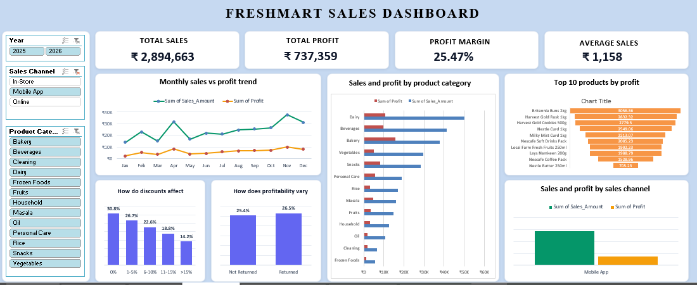

# 🛒 FreshMart – Retail Sales Analytics Project

> **Retail Sales Data Analysis and Dashboard Project using Microsoft Excel**

## 🎯 Objective

To analyze FreshMart retail transaction data and build an Excel-based dashboard that helps explore sales, profit, order volume, product categories, regions, customer membership, discounts, returns, payment modes, sales channels, and store performance.

## 🛠️ Tools & Techniques Used

- Microsoft Excel
- Data Cleaning and Data Profiling
- Pivot Tables
- KPI Summaries
- Sales and Profit Analysis
- Data Visualization
- Dashboard Design

## 📁 Workbook Structure

The Excel project includes the following worksheets:

- **Store** – store details, region, location, type, monthly target, and status.
- **Employee** – employee details, department, salary, joining date, store assignment, and employment status.
- **Customer** – customer profile, region, membership, and registration details.
- **Product** – product name, category, subcategory, brand, prices, supplier, season, and status.
- **Sales_Trans** – transaction records with sales, cost, profit, payment, return, channel, and related lookup fields.
- **Sales_Trans_1** – transaction data with additional analysis fields such as year, month, profit margin, and discount band.
- **Sales_Transactions** – transaction-level dataset with 2,500 records and core sales fields.
- **Pivot_KPIs** – PivotTable summaries for KPIs and different sales-analysis dimensions.
- **Dashboard** – dashboard worksheet.
- **Data_Profiling** – data-quality issues identified during profiling and the recorded handling steps.
- **Insights & Recommendation** – worksheet reserved for insights and recommendations.

## 📌 Key KPIs

| Metric | Value |
| --- | ---: |
| 💰 Total Sales | ₹28,94,662.90 |
| 📈 Total Profit | ₹7,37,358.89 |
| 📊 Profit Margin | 25.47% |
| 🧾 Total Orders / Invoices | 2,500 |
| 🛒 Average Sales per Invoice | ₹1,157.87 |

*Values are based on the KPI summaries available in the uploaded workbook.*

## 📊 Analysis Areas

- 📈 Sales and profit trends by year and month
- 🌍 Region-wise sales and profit
- 🏷️ Discount-band analysis
- 🛍️ Category-level sales and profit
- 💰 Product-level sales and profit
- 🔄 Returned vs. not-returned transactions
- 👥 Customer membership analysis
- 💳 Payment-mode analysis
- 🛒 Sales-channel analysis
- 🏪 Store and employee performance summaries
- 🎯 Store targets and performance fields available in the source data

## 🧹 Data Profiling & Cleaning

The **Data_Profiling** worksheet documents data-quality checks and recorded actions, including:

- Duplicate invoice numbers were identified and highlighted.
- Inconsistent transaction-date formats were standardized.
- Blank customer, product, store, and employee IDs were identified.
- Sales amount formatting was normalized by removing the `Rs` text.
- Payment-mode values were standardized.
- Order-time values stored as text were converted to numeric/time values.

These are the actions documented in the workbook's profiling sheet; the sheet does not establish that every issue has been fully resolved.

## 💡 Key Insights

- The workbook's KPI summary reports total sales of approximately **₹28.95 lakh**.
- Reported total profit is approximately **₹7.37 lakh**, with a profit margin of **25.47%**.
- The dataset contains **2,500 invoices/transactions** in the core `Sales_Transactions` worksheet.
- The PivotTable summaries support comparisons across months, regions, discount bands, product categories, return status, customer membership, and payment modes.
- The workbook includes fields for store targets, sales channels, and order time, which can support further operational analysis.

## ✅ Project Status

**Completed | FreshMart Retail Sales Analytics Project**

---

### 👨‍💻 Skills Demonstrated

**Excel • Data Cleaning • Data Profiling • Pivot Tables • KPI Analysis • Sales Analysis • Data Visualization • Dashboard Development**
