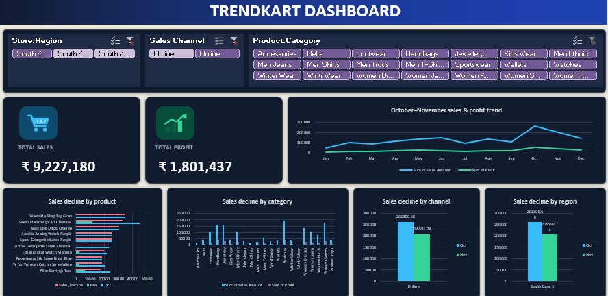

# 🛒 TrendMart – Retail Sales Dashboard

> **Interactive Retail Sales Analysis Dashboard using Microsoft Excel**

## 🎯 Objective

To analyze **TrendMart retail sales data** and create an interactive dashboard that provides insights into **Sales, Profit, Quantity, Orders, Returns, Regions, States, Categories, Membership, Payment Methods, Sales Channels, Discounts, Products, Brands, and Store Performance**.

## 🛠️ Tools Used

* Microsoft Excel
* Data Cleaning and Data Profiling
* Pivot Tables
* Pivot Charts
* Data Visualization
* Dashboard Design

## 📌 Key KPIs

| Metric | Value |
| --- | ---: |
| 💰 Total Sales | ₹92,27,179.96 |
| 📈 Total Profit | ₹18,01,437.12 |
| 📊 Profit Margin | 19.52% |
| 💸 Total Cost | ₹65,96,441.12 |
| 🧾 Total Orders | 3,000 |
| 📦 Total Quantity | 6,100 |
| 🔄 Returns Rate | 4.87% |

## 📊 Dashboard Analysis

* 📈 **Monthly Sales & Profit Trend**
* 👥 **Sales by Membership**
* 🌍 **Sales by State**
* 💳 **Sales by Payment Mode**
* 🏪 **Top 10 Stores by Sales**
* 🛍️ **Top 10 Products by Sales**
* 📊 **Category Sales & Profit Analysis**
* 🏷️ **Discount vs Profitability Analysis**
* 🛒 **Sales by Channel**
* 🔄 **Return Analysis**
* 💰 **High Sales – Low Profit Products**
* 🏆 **Top Brands by Profit Margin**
* 🎯 **Interactive Region Filter**
* 💡 **Key Insights & Actions**

## 💡 Key Insights

* Total sales are approximately **₹92.27 Lakhs**.
* Total profit is approximately **₹18.01 Lakhs**, with a calculated profit margin of approximately **19.52%**.
* The `Sales_Transactions` worksheet contains **3,000 transaction rows**.
* Total quantity across those transaction rows is **6,100**.
* The transaction data contains **146 return-related status entries** when the recorded variants (`Returned`, `Retured`, and `returned`) are grouped together, giving an approximate return rate of **4.87%**.
* **Offline sales** account for approximately **65.56%** of sales amount, while **online sales** account for approximately **34.44%**.
* The workbook supports state-wise comparisons across **Karnataka, Telangana, Kerala, Tamil Nadu, and Andhra Pradesh**.
* Store, product, category, brand, discount, and return analyses can help investigate sales and profitability differences.
* High-sales, low-profit products can be identified for further review.

## 🧹 Data Profiling

The **Data_Profiling** worksheet records data-quality issues identified in the workbook, including:

* Duplicate invoice numbers
* Blank customer, product, and employee IDs
* Mixed date formats
* Quantity values stored as text and zero quantities
* Extra spaces and inconsistent capitalization in payment modes
* Negative profit values
* Inconsistent return-status values
* Duplicate customer phone numbers and invalid email values
* Inconsistent customer gender and membership values
* Duplicate product names and category spelling issues
* Missing store manager names and status typos
* Inconsistent employee names and employment-status values

These items are recorded as profiling findings; their presence in the profiling sheet does not by itself confirm that every issue has been corrected.

## 📁 Workbook Sheets

* **Sales_Transactions** – transaction-level sales data.
* **Sales** – sales data enriched with customer, product, store, and employee attributes.
* **Customers / Customer** – customer details, region, and membership information.
* **Products / Product** – product, category, subcategory, and brand information.
* **Stores / Store** – store locations, regions, store types, and targets.
* **Employees / Employee** – employee roles, store assignments, and performance details.
* **Suppliers / Supplier** – supplier contact and performance information.
* **Pivot_Analysis** – PivotTable summaries used for analysis.
* **Dashboard** – dashboard worksheet.
* **Insights & Recommendations** – worksheet for project insights and recommendations.
* **Data_Profiling** – recorded data-quality checks and findings.

## ✅ Project Status

**TrendMart Excel Retail Sales Analytics Project**

---

### 👨‍💻 Skills Demonstrated

**Excel • Data Cleaning • Data Profiling • Data Analysis • Pivot Tables • Data Visualization • Dashboard Development**
