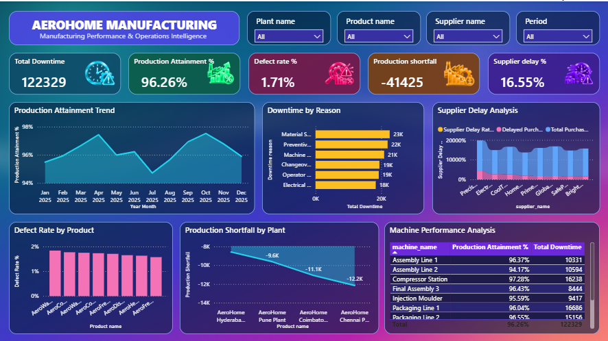

# Aero Home Production Performance Dashboard

## Dashboard

The AeroHome dashboard is a single 1280 × 720 report page (`AeroHome`) that converts the business problem into a focused operational-performance story. It uses a custom **AeroHome Aurora** theme and background image.



## Business Problem

### How can AeroHome improve production plan attainment by identifying the plants, downtime causes, quality issues, and supplier delays contributing to the production shortfall?

AeroHome's Production Performance Dashboard was developed to understand the gap between planned and actual production and identify the operational factors that may be contributing to production shortfalls.

The dashboard focuses on a specific COO-level operational path rather than attempting to answer every analytical question in the manufacturing dataset.

The analysis concentrates on:

1. **Are we meeting our production plan?**
2. **What are the main causes of production downtime?**
3. **Which suppliers have the highest purchase-order delays?**
4. **Which plants have the largest production shortfall?**
5. **Which products have the highest defect rates?**
6. **Which machines are underperforming?**

### Business Objective

**Improve production plan attainment by identifying the plants, downtime causes, quality issues, supplier delays, and machine-level performance factors associated with production shortfalls.**

### Solution

The AeroHome dashboard connects production performance with the operational factors that management can investigate.

1. **Measure production plan attainment**
   - Compare actual production with planned production.
   - Track Production Attainment % as a key performance indicator.
   - Use the monthly trend to identify periods where production is below plan.

2. **Identify production shortfall at plant level**
   - Compare plant contributions to production shortfall.
   - Prioritize the plants with the largest shortfall for operational investigation.

3. **Identify downtime causes**
   - Rank downtime reasons by total downtime.
   - Identify the downtime areas that should be addressed first.

4. **Investigate quality performance**
   - Identify products with comparatively high defect rates.
   - Use product-level quality results to identify areas requiring further review.

5. **Review machine performance**
   - Compare Production Attainment % and Total Downtime by machine.
   - Identify machines that combine weaker production attainment with higher downtime.

6. **Review supplier delivery risk**
   - Identify suppliers with higher purchase-order delay rates.
   - Highlight suppliers that may require operational or procurement follow-up.

---

## Dataset / Source Details

The project uses the provided **AeroHome Manufacturing Dataset** and was modeled and analyzed in **Microsoft Power BI** (`AeroHome.pbix`).

### Dataset Structure

| Sheet / Table | Purpose |
|---|---|
| `dim_plants` | Plant master data, location and daily production capacity |
| `dim_products` | Product master data, product type, category, unit cost and target price |
| `dim_machines` | Machine master data, machine type, plant and installation year |
| `dim_operators` | Operator information, plant, shift, experience and hourly rate |
| `dim_suppliers` | Supplier master data, country and supplier rating |
| `dim_materials` | Raw-material master data and standard cost |
| `bridge_bill_of_materials` | Product-to-material relationship and required material quantity; also holds the report's DAX measures |
| `fact_production` | Production runs, planned units, produced units, defects, downtime and energy consumption |
| `fact_quality` | Quality inspections, inspected units, defective units, defect type and inspection status |
| `fact_downtime` | Downtime events, reasons, categories, machines and downtime minutes |
| `fact_purchase_orders` | Purchase orders, suppliers, materials, quantities, prices, lead times and delivery status |
| `DateTable` | Calendar table used for Year Month filtering and the monthly trend |

The dataset contains **2,210 production records**, **2,200 quality inspection records**, **1,300 downtime records**, and **1,100 purchase-order records**, along with the supporting dimension and bridge tables.

---

### How the dashboard addresses the business problem

| Business Question | Dashboard Solution | Business Use |
|---|---|---|
| **Are we meeting our production plan?** | Production Attainment Trend (line and column combo chart) | Shows whether actual production is keeping pace with the production plan |
| **What are the main causes of production downtime?** | Downtime by Reason (clustered bar chart) | Identifies the downtime reasons accounting for the most lost time |
| **Which suppliers have the highest purchase-order delays?** | Supplier Delay Analysis (ribbon chart) | Ranks suppliers by delay rate alongside total and delayed purchase orders |
| **Which plants have the largest production shortfall?** | Production Shortfall by Plant (stacked area chart) | Identifies plants contributing most to the overall shortfall |
| **Which products have the highest defect rates?** | Defect Rate by Product (clustered column chart) | Identifies products requiring quality investigation |
| **Which machines are underperforming?** | Machine Performance Analysis (table) | Compares production attainment and downtime to identify machines requiring attention |

---

## KPIs / Features Explained

The top row of the dashboard holds five KPI cards, each with its own icon.

### Total Downtime

Total machine downtime in the current report context.

### Production Attainment %

Measures actual production against planned production.

**Production Attainment % = Actual Production ÷ Planned Production**

A value below 100% indicates that actual production is below the planned production level.

### Production Shortfall

The production gap between actual and planned production. A negative value indicates that actual production is below planned production.

### Defect Rate %

The share of produced units that are defective, giving an overall indication of production quality performance.

### Supplier Delay %

The share of purchase orders that were delayed, giving an overall indication of supplier delivery risk.

---

## Dashboard Features

### 1. Production Plan Attainment

A **combined line and stacked column chart** tracks Production Attainment % across Year Month.

**Business purpose:**
Shows when production is falling below plan and allows management to identify periods requiring attention.

### 2. Downtime Cause Analysis

A **clustered bar chart** ranks Total Downtime by downtime reason.

**Business purpose:**
Identifies the downtime causes responsible for the largest share of lost production time.

### 3. Supplier Delay Analysis

A **ribbon chart** compares suppliers by Supplier Delay Rate %, with Total Purchase Orders and Delayed Purchase Orders in the tooltip.

**Business purpose:**
Allows management to identify suppliers with higher delay rates while considering the volume of purchase orders they handle.

### 4. Plant Production Shortfall

A **stacked area chart** shows Production Shortfall by plant.

**Business purpose:**
Helps management identify which plants are driving the production gap.

### 5. Product Defect Rate

A **clustered column chart** compares products by Defect Rate %.

**Business purpose:**
Highlights products with comparatively high defect rates for quality investigation.

### 6. Machine Performance

A **table** compares Machine Name, Production Attainment %, and Total Downtime.

**Business purpose:**
Helps identify machines that may require attention because of weaker production attainment and/or higher downtime.

---

## Tools / Power BI Techniques Used

The project was developed using **Microsoft Power BI** and includes:

- Power Query data cleaning and transformation
- Data modeling with fact and dimension tables
- Date table and relationships between tables
- DAX measures
- KPI card visuals
- Line and column combo chart, ribbon chart, clustered bar and column charts, stacked area chart, and table visual
- Interactive slicers (dropdown style)
- Interactive cross-filtering
- Custom theme (`AeroHome Aurora`), background image and KPI icons
- Business-question-driven visualization
- Executive dashboard storytelling

---

## Key Measures

### Actual Production

```DAX
Actual Production =
SUM(fact_production[quantity_produced])
```

### Planned Production

```DAX
Planned Production =
SUM(fact_production[planned_units])
```

### Production Attainment %

```DAX
Production Attainment % =
DIVIDE(
    [Actual Production],
    [Planned Production],
    0
)
```

The Production Attainment % measure compares actual production with planned production and is used as the main production-performance indicator.

Additional measures in the dashboard support:

- Total Downtime
- Production Shortfall
- Defect Rate %
- Supplier Delay Rate %
- Total Purchase Orders
- Delayed Purchase Orders

---

## Dashboard Filters

The dashboard provides interactive dropdown slicers for:

- **Plant name**
- **Product name**
- **Supplier name**
- **Period** (Year Month)

These slicers allow management to move from the overall AeroHome view to specific plants, products, suppliers and time periods.

---

## Key Insights

The dashboard is designed to support the following operational conclusions:

1. **Production plan attainment** - Production Attainment % and its monthly trend show whether actual output is below the planned level.
2. **Production shortfall** - The Production Shortfall KPI establishes the production gap as the central operational issue.
3. **Plant concentration** - The plant shortfall chart lets management focus on the largest contributors instead of treating the shortfall as a uniform company-wide problem.
4. **Downtime** - The downtime-by-reason ranking helps prioritize the causes that account for the greatest amount of lost production time.
5. **Product quality** - The defect-rate chart highlights products that can be investigated for process, material or production-quality issues.
6. **Machine-level diagnosis** - The machine table combines Production Attainment % with Total Downtime to identify machines contributing to weaker performance.
7. **Supplier delays** - The supplier analysis highlights suppliers with higher purchase-order delay rates alongside their order volume.

---

## Recommendations / Conclusion

### Recommendations

Based on the selected business problem and dashboard analysis, AeroHome should:

- Investigate the plants with the largest Production Shortfall.
- Review the major downtime reasons and prioritize the causes accounting for the largest share of lost time.
- Investigate products with the highest defect rates for possible quality and process issues.
- Review machines with lower Production Attainment % and higher Total Downtime.
- Follow up with suppliers showing higher purchase-order delay rates.
- Use the plant, product, supplier and period slicers to perform targeted investigation instead of relying only on overall KPIs.
- Continue monitoring Production Attainment % over time so that deviations from plan can be identified early.

### Conclusion

The AeroHome dashboard provides a focused **COO-level operational performance view** centered on improving production plan attainment.

The analytical story follows:

**Production Plan → Production Shortfall → Plant Contribution → Downtime Causes → Quality Issues → Machine Performance → Supplier Delays**

The dashboard supports management in moving from **identifying the production gap** to **understanding where the gap is occurring and which operational areas require further investigation**.

---

## Project Outcome

This project demonstrates practical skills in:

- Power BI data cleaning and transformation
- Data modeling
- DAX measure development
- KPI creation
- Production plan attainment and shortfall analysis
- Plant, product, machine and supplier performance analysis
- Downtime root-cause analysis
- Interactive slicers
- Executive dashboard design
- Business-question-driven visualization
- Data-driven recommendations

The final output is an interactive **AeroHome Production Performance Dashboard** designed to help management improve production plan attainment by identifying the plants, downtime causes, quality issues, machine performance factors and supplier delays associated with operational shortfalls.
