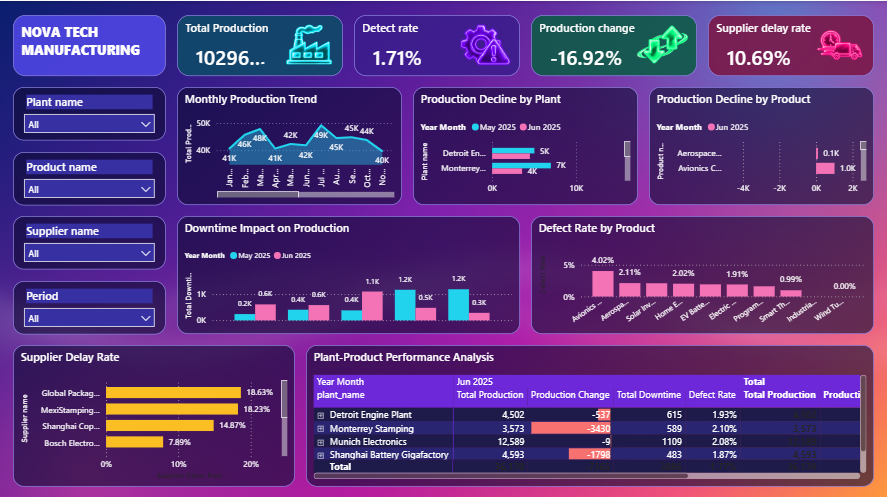

# NovaTech Production Decline Dashboard

## Dashboard

The dashboard is a single 1280 × 720 report page (`NovaTech`) using a custom **NovaTech Aurora** theme and background image.

## Business Problem

### Why did production decline from May 2025 to June 2025, and which plants, products, downtime, quality issues and supplier delays contributed to it?

The NovaTech dashboard was developed to understand the month-over-month change in production and identify the operational factors that may be contributing to the decline.

The dashboard focuses on a specific operational path rather than attempting to answer every analytical question in the manufacturing dataset.

The analysis concentrates on:

1. **How is production changing over time?**
2. **Which plants have the largest production decline?**
3. **Which products have the largest production decline?**
4. **How does downtime affect production by plant?**
5. **Which products have the highest defect rates?**
6. **Which suppliers have the highest delay rates?**
7. **Which plant and product combinations are underperforming?**

### Business Objective

**Explain the production decline by identifying the plants, products, downtime, quality issues and supplier delays associated with it.**

### Solution

1. **Track production and change over time**
   - Monitor Total Production on a monthly trend.
   - Track Production Change % between months as a headline KPI.

2. **Locate the decline**
   - Rank plants by production decline.
   - Rank products by production decline.

3. **Test downtime as a cause**
   - Compare Total Downtime with production by plant over the selected months.

4. **Investigate quality performance**
   - Compare Defect Rate across products over the selected months.

5. **Review supplier delivery risk**
   - Rank suppliers by Supplier Delay Rate.

6. **Drill into plant-product performance**
   - Use a matrix to compare Total Production, Production Change, Total Downtime and Defect Rate by plant and product.

---

## Dataset / Source Details

The project uses the **NovaTech manufacturing dataset** and was modeled and analyzed in **Microsoft Power BI** (`NovaTech.pbix`).

### Dataset Structure

| Table | Purpose |
|---|---|
| `dim_plants` | Plant master data |
| `dim_products` | Product master data |
| `dim_operators` | Operator information |
| `dim_suppliers` | Supplier master data |
| `dim_raw_materials` | Raw-material master data |
| `bridge_bill_of_materials` | Product-to-material relationship; also holds the report's DAX measures |
| `fact_production_runs` | Production runs: planned and produced units, defects and downtime |
| `fact_purchase_orders` | Purchase orders, suppliers, materials and delivery status |
| `DateTable` | Calendar table (Year, Month Name, Year Month) used for the trend and period filtering |

---

### How the dashboard addresses the business problem

| Business Question | Dashboard Solution | Business Use |
|---|---|---|
| **How is production changing over time?** | Monthly Production Trend (line chart) and Production Change % card | Shows the direction and size of the change |
| **Which plants have the largest production decline?** | Production Decline by Plant (clustered bar chart) | Identifies plants driving the decline |
| **Which products have the largest production decline?** | Production Decline by Product (clustered bar chart) | Identifies products driving the decline |
| **How does downtime affect production?** | Downtime Impact on Production (line and clustered column combo chart) | Compares downtime with production by plant |
| **Which products have the highest defect rates?** | Defect Rate by Product (line and column combo chart) | Identifies products needing quality review |
| **Which suppliers have the highest delays?** | Supplier Delay Rate (clustered bar chart) | Highlights suppliers needing follow-up |
| **Which plant-product combinations underperform?** | Plant-Product Performance Analysis (matrix) | Combines production, change, downtime and defect rate |

---

## KPIs / Features Explained

The dashboard has four KPI cards, each with its own icon.

| KPI | Meaning |
|---|---|
| **Total Production** | Total units produced in the current filter context |
| **Production Change %** | Change in production versus the comparison month |
| **Defect Rate** | Share of produced units that are defective |
| **Supplier Delay Rate** | Share of purchase orders that were delayed |

---

## Dashboard Features

### 1. Monthly Production Trend
A **line chart** tracks Total Production by Year Month.
**Business purpose:** shows when production starts to fall.

### 2. Production Decline by Plant
A **clustered bar chart** compares Total Production by plant across the selected months.
**Business purpose:** identifies the plants with the largest decline.

### 3. Production Decline by Product
A **clustered bar chart** shows Production Change by product.
**Business purpose:** identifies the products with the largest decline.

### 4. Downtime Impact on Production
A **line and clustered column combo chart** shows Total Downtime by plant across the selected months.
**Business purpose:** tests whether downtime explains the decline.

### 5. Defect Rate by Product
A **line and stacked column combo chart** shows Defect Rate by product across the selected months.
**Business purpose:** highlights products with rising or high defect rates.

### 6. Supplier Delay Rate
A **clustered bar chart** ranks suppliers by Supplier Delay Rate.
**Business purpose:** identifies suppliers that may need procurement follow-up.

### 7. Plant-Product Performance Analysis
A **matrix** shows Total Production, Production Change, Total Downtime and Defect Rate by plant and product, with conditional color formatting.
**Business purpose:** pinpoints the specific plant-product combinations behind the decline.

---

## Tools / Power BI Techniques Used

- Power Query data cleaning and transformation
- Data modeling with fact and dimension tables
- Date table and relationships between tables
- DAX measures (including month-over-month Production Change and Production Change %)
- KPI card visuals with icons
- Line, clustered bar, line and column combo charts, and matrix visual
- Visual-level filtering to the compared months (May 2025 and Jun 2025)
- Interactive dropdown slicers and cross-filtering
- Custom theme, background image and grouped layout
- Business-question-driven visualization

---

## Key Measures

The report's measures are held on `bridge_bill_of_materials`:

- Total Production
- Production Change
- Production Change %
- Total Downtime
- Defect Rate
- Supplier Delay Rate

---

## Dashboard Filters

Interactive dropdown slicers are provided for:

- **Plant name**
- **Product name**
- **Supplier name**
- **Period** (Year and Month Name)

These let management move from the overall view to specific plants, products, suppliers and time periods.

---

## Key Insights

The dashboard is designed to support these conclusions:

1. **Production is moving down** - the monthly trend and Production Change % show the size of the decline.
2. **The decline is concentrated** - the plant and product charts show which plants and products contribute most.
3. **Downtime is a factor to test** - the downtime combo chart shows whether plants with more downtime lost more production.
4. **Quality varies by product** - the defect-rate chart flags products needing review.
5. **Supplier delays are a supporting risk** - the supplier chart highlights delay exposure.
6. **Plant-product detail** - the matrix shows where the factors combine.

---

## Recommendations / Conclusion

### Recommendations

- Investigate the plants and products with the largest production decline.
- Review plants where higher downtime coincides with lower production.
- Investigate products with the highest defect rates.
- Follow up with suppliers showing higher delay rates.
- Use the slicers for targeted investigation rather than relying only on overall KPIs.
- Keep monitoring Production Change % so declines are caught early.

### Conclusion

The NovaTech dashboard gives an operational view centered on explaining a production decline.

**Production Trend → Production Change → Plant and Product Decline → Downtime → Quality → Supplier Delays → Plant-Product Detail**

It supports management in moving from **identifying that production fell** to **understanding where and why it fell**.

---

## Project Outcome

This project demonstrates practical skills in:

- Power BI data cleaning and transformation
- Data modeling and DAX measure development
- KPI creation and month-over-month analysis
- Plant, product, quality, downtime and supplier analysis
- Matrix design with conditional formatting
- Interactive slicers
- Executive dashboard design
- Data-driven recommendations
